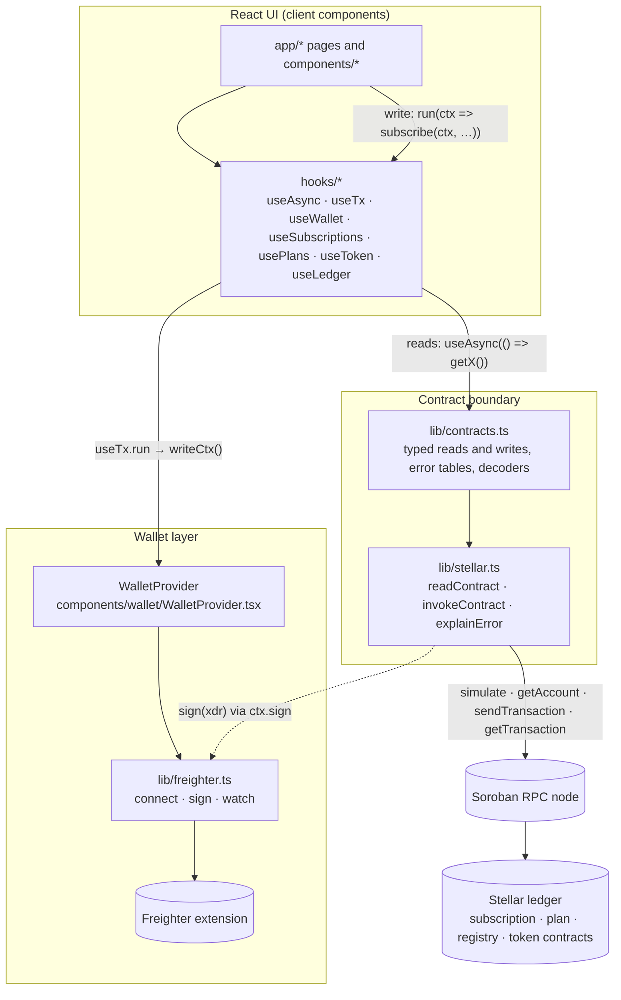

# Architecture: data flow, hooks and the contract boundary

This page explains how reads, writes and the wallet fit together. Read it before changing anything that talks to Stellar. Every file path below is relative to the repo root, and every claim describes the code as it is today.

## The one-minute version

- The app never holds keys. Reads are simulations with a throwaway source account. Writes are built in the browser, signed by Freighter, then submitted.
- The on-chain contracts are the source of truth. The UI shows what the contract would allow and never more. A merchant can never charge above the cap or before the schedule allows, and the UI must say so truthfully.
- Two layers keep this split clean:
  - `lib/stellar.ts` is the generic Soroban engine. It knows about RPC, simulation, signing and confirmation, and nothing about subscriptions.
  - `lib/contracts.ts` holds the typed bindings for the subscription, plan and registry contracts, plus the SEP-41 token interface. It is the only place that names contract methods, arguments and error codes.

## Diagram

## Layers

### `lib/stellar.ts`: the engine

- `NETWORKS` holds per-network config: RPC URL, passphrase, explorer, and `readAccount`. The read account is a funded address used only as the source of read simulations. Mainnet has no read account unless `NEXT_PUBLIC_MAINNET_READ_ACCOUNT` is set, and reads then fail with a readable "isn't configured" error.
- `getServer(network)` caches one `rpc.Server` per network.
- `readContract(network, contractId, method, args, errors)` builds a transaction from the read account, simulates it and decodes `retval`. Nothing is signed or submitted.
- `invokeContract(ctx, contractId, method, args, errors)` is the write pipeline. It runs in this order, and each step reports a phase through `ctx.onPhase`:
  1. `building`: load the source account, build the transaction, simulate it, and assemble the prepared transaction.
  2. `signing`: hand the XDR to `ctx.sign`, which is Freighter.
  3. `submitting`: `sendTransaction`. `ERROR` and `TRY_AGAIN_LATER` become a `ContractError`.
  4. `confirming`: poll `getTransaction` every 2 seconds for up to 60 seconds.

  Because simulation runs before signing, a contract rejection shows up as a message before the wallet is ever asked to sign.
- `withRetry` retries three times, with backoff, only for transient failures such as rate limits, timeouts and network errors. Contract errors are never retried.
- `ContractError` is the error type the UI can show. It carries a `message` safe for people, an optional raw `detail` for the console, and an optional contract error `code`.
- `explainError(raw, errors)` maps a simulation failure to a sentence. A `Error(Contract, #n)` string looks up the per-contract table. A balance or trustline message becomes "doesn't hold enough of this token". Anything else becomes a generic network message.

### `lib/contracts.ts`: the boundary

This is the only module that knows contract names.

- `DEPLOYMENTS` maps each network to the subscription, plan and registry contract IDs. Testnet has built-in defaults, and each ID can be overridden by an env var. Mainnet is `null` until all three mainnet env vars are set. Calls then throw `NotDeployedError`.
- Error tables `SUBSCRIPTION_ERRORS`, `PLAN_ERRORS` and `REGISTRY_ERRORS` map contract error codes to sentences. The comment on them says the codes are append-only in the contracts. Add new codes at the end and never renumber.
- Decoders (`decodeSubscription`, `decodePlan`, `decodeStats`, `decodeChargeEvent`) turn native values into the types in `types/index.ts`. `toNumber` and `toBigInt` guard the conversions.
- Reads: `getSubscription`, `getSubscriptionsBySubscriber`, `getSubscriptionsByMerchant`, `isChargeable`, `getPlan`, `getActivePlans`, `getPlansByMerchant`, `getRegistryStats`, `getTokenInfo` (cached per network and token), `getTokenBalance`, `getSubscriptionAllowance`, and `getChargeEvents` (recent `charged` events from RPC).
- Writes, each taking a `WriteCtx`:
  - Subscriber: `subscribe`, `cancelSubscription`, `pauseSubscription`, `resumeSubscription`, `refreshAllowance`.
  - Merchant: `charge`, `createPlan`, `deactivatePlan`.

  `charge` calls `isChargeable` on-chain first and refuses to send if the contract would refuse. It is the only write with a `checking` phase.

Types that cross the boundary live in `types/index.ts`. `SubStatus` mirrors the contract's discriminants and is never renumbered.

### `lib/freighter.ts`: the wallet adapter

Freighter returns `{ error }` objects instead of throwing. This module turns them into `WalletError`s with plain messages. A declined request becomes "You declined the request in Freighter. Nothing was signed or sent." It also maps Freighter's passphrase onto our `Network` type, and exposes `watchWallet`, a poller, because Freighter has no push events.

## Wallet: `WalletProvider` and `useWallet`

`WalletProvider` is mounted once in `app/layout.tsx`. It owns:

- `address`: the connected account. It is restored from `localStorage` (`subs.wallet.connected`) on load, if Freighter still grants access.
- `network`: while connected, the app follows Freighter's network. While disconnected, the user can browse either network through `setNetwork`. This keeps what you see and what you sign in agreement.
- `walletNetwork`: the network Freighter reports, or `null` when it is neither Testnet nor Mainnet.
- `watchWallet` polling, which pauses while the tab is hidden. It follows account and network switches made in Freighter.
- `writeCtx(onPhase)`: returns a `WriteCtx` for the connected account. It throws a readable error when no account is connected or Freighter is on an unknown network.

Components read this state through `useWallet()`. Calling it outside the provider throws.

## Hooks

| Hook | File | What it does |
| --- | --- | --- |
| `useWallet` | `hooks/useWallet.ts` | Reads `WalletState` from context. |
| `useAsync(load, deps)` | `hooks/useAsync.ts` | Runs a loader when `deps` change. Returns `{ data, error, loading, reload }`. Passing `null` stays idle. Stale responses are discarded, so switching accounts never shows the previous account's data. |
| `useTx()` | `hooks/useTx.ts` | Drives one write. `run(action)` calls `action(writeCtx(setPhase))`, tracks `phase`, `hash` and `error`, and resolves to the result or `null`. |
| `useSubscriptions`, `useSubscription`, `useMerchantSubscriptions` | `hooks/useSubscriptions.ts` | Subscription reads, keyed on network and account. |
| `usePlans`, `usePlan`, `useMerchantPlans` | `hooks/usePlans.ts` | Plan reads, keyed on network. |
| `useToken`, `useTokenBalance` | `hooks/useToken.ts` | Token metadata and balance. |
| `useLedger(network)` | `hooks/useLedger.ts` | The latest ledger, refreshed every 15 seconds. Countdowns use it, because the contracts schedule charges by ledger number, not by the local clock. |

Read hooks are thin wrappers. For example, `useSubscriptions` calls `useAsync(() => getSubscriptionsBySubscriber(network, subscriber), [network, subscriber])`.

Write flows do not use `useAsync`. They use `useTx`.

## Trace: subscribe, from click to transaction

This is the path a new contributor should be able to follow end to end.

1. **Plan page.** `app/plans/[id]/page.tsx` loads the plan with `usePlan`, and `SubscribeForm` renders with it.
2. **The form.** `components/subscribe/SubscribeForm.tsx` holds the chosen cap. `CapSelector` reports changes through `onChange`. `AuthorizationSummary` states what the cap allows. The "Authorize and subscribe" button stays disabled until there is a cap, the user has ticked "I've read what I'm authorizing", and no write is in progress.
3. **Click.** `confirm()` calls `tx.run(ctx => subscribe(ctx, {...}))`.
4. **`useTx.run`.** It clears the previous error, sets the phase to `building`, and calls `writeCtx(setPhase)`. That produces `{ network, source, sign, onPhase }`, where `sign` goes to `signWithFreighter`.
5. **`subscribe`** (`lib/contracts.ts`). It calls `invokeContract` with the subscription contract ID and seven arguments: the subscriber, merchant, token, amount per period, interval, total cap and plan ID. It uses `SUBSCRIPTION_ERRORS`.
6. **`invokeContract`** (`lib/stellar.ts`):
   - `building`: loads the account, builds the transaction, simulates it, and assembles it. A contract rejection stops here and is mapped by `explainError`.
   - `signing`: Freighter asks the user to approve the transaction.
   - `submitting`: the signed transaction is sent.
   - `confirming`: polls until the ledger confirms.
7. **Return.** `invokeContract` returns `{ hash, returnValue }`. `subscribe` converts `returnValue` into the new subscription `id`.
8. **Back in `useTx.run`.** It stores the hash, sets the phase to `success`, and returns the result. `confirm()` then calls `setSubscriptionId(result.id)`, and the form switches to the success view.

`subscribe` does not pre-check with `isChargeable`. It is a subscriber action, and the contract validates its arguments during simulation.

## How errors reach the UI

There are three routes, and each one ends in a sentence a person can read.

| Where it fails | What gets thrown | Where it is shown |
| --- | --- | --- |
| A read (`readContract`, a read hook) | `ContractError`, `NotDeployedError`, or a plain `Error` | `useAsync` stores it as `error`. Pages render `ErrorState`, which shows the message. `NotDeployedError` gets a "Not available on this network" title. |
| A write (`invokeContract`, `WalletError`, or the write context) | `ContractError`, `WalletError`, or a plain `Error` | `useTx.run` catches it. If it is a `ContractError` with a `detail`, the detail goes to `console.error`. The message goes into `tx.error`, with phase `error`. |
| Rendering a write's state | — | `TxProgress` renders the phase. It shows the step list while in progress, a success line with an explorer link, or a `role="alert"` message on error. |

Two details matter when you add a new error:

- A contract code becomes a sentence only if it is in the matching table in `lib/contracts.ts`. Otherwise the user sees "The contract rejected this (error N)."
- A non-`Error` value thrown from a write becomes "Something went wrong. Nothing was changed." Do not throw strings from new write code. Throw `ContractError` or `Error`.

`confirm()` throws after 60 seconds with "Still waiting for the network to confirm. It may yet succeed — check the explorer before retrying." This is deliberate. The transaction might still succeed, so the UI must not suggest it failed.

## The contract boundary and the cap

The contracts enforce these rules. The UI must describe them truthfully and never offer a state that breaks them.

- A subscription has a total cap, and the subscriber approves the token contract to pull up to that cap. A charge can never take the total charged above the cap. Error 12 says so, and `AuthorizationSummary` says so in plain words.
- Every charge is exactly `amountPerPeriod`. A leftover smaller than one period can never be charged. `lib/subscription.ts` (`remainingChargeable`, `chargesLeft`) counts only what can be charged.
- A charge can happen only when the contract allows it. That means the subscription is active, not cancelled, not exhausted, and `nextChargeLedger` has been reached. Error 11 covers "too early". `charge()` asks `is_chargeable` first, so the merchant side is not sent to fail on-chain.
- Cancelling is final. `CancelButton` says "After you cancel, no further charges can occur." That is the contract's behaviour, and the copy has to match it.
- Pausing stops charges until resume. A missed period is not billed in a burst. `PauseResumeButton` says so.

When you write new copy about a subscription, derive it from these rules. `lib/subscription.ts` reproduces the contract's calculations so the UI never claims more than the contract allows. Do not let a component compute an amount the contract doesn't.

## Where things are not finished

These are facts about the code today. Check them before relying on them.

- The merchant write functions (`charge`, `createPlan`, `deactivatePlan`) and the merchant hooks (`useMerchantPlans`, `useMerchantSubscriptions`) exist, but no screen calls them yet. Links to `/merchant` and `/merchant/plans/new` point at routes that are not in `app/`.
- `TxProgress` accepts `withCheck` for the eligibility step. Nothing passes `true`, so the `checking` step is never shown, even though `charge()` sets that phase.
- Mainnet is not deployed by default. It only works when all three `NEXT_PUBLIC_MAINNET_*_CONTRACT` variables are set.
- The contract source is not in this repository. The error tables and `DEPLOYMENTS` mirror it, so when the contract changes, update `lib/contracts.ts` and `types/index.ts` in the same change. `.env.example` points to the contracts repo for the deployment record.

## Changing this code

- Add a new contract method in `lib/contracts.ts` as a thin function over `invokeContract` or `readContract`. Pass the matching error table.
- Add new error codes to the end of the table. Never renumber.
- Add a new write in a component with `const tx = useTx()`, then `tx.run(ctx => yourFn(ctx, args))`, and render `TxProgress` with `tx.phase`, `tx.hash` and `tx.error`.
- Add a new read as a hook with `useAsync`, and keep `network` and the account in its `deps`.
- Keep `lib/stellar.ts` free of contract-specific names. If a change needs one, it belongs in `lib/contracts.ts`.
