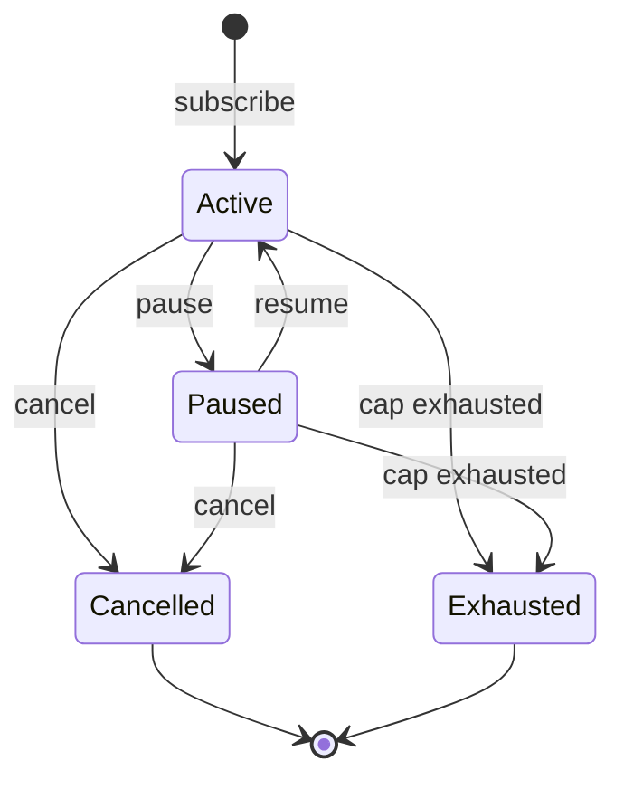

# Subscription Lifecycle

This document explains the `SubStatus` state machine enforced by the subscription contract. Every subscription is in exactly one of four states, and the contract only permits specific transitions between them.

## `SubStatus` values

| Status | Meaning |
| --- | --- |
| `Active` | The subscription is live. The contract may charge the subscriber up to the remaining cap. |
| `Paused` | The subscription is temporarily suspended. No charges occur while paused. |
| `Cancelled` | The subscription has been terminated by the subscriber. It can never be charged again. |
| `Exhausted` | The subscription's chargeable cap has been fully consumed. Nothing is left to charge. |

## State transition diagram



In ASCII form:

```
            subscribe
   [*] ─────────────────▶ Active
                          │  ▲
                    pause │  │ resume
                          ▼  │
                         Paused
                          │  │
              cancel ─────┘  └───── cancel
                 │                  │
                 ▼                  ▼
             Cancelled          Cancelled
                 ▲                  ▲
                 │   cap exhausted  │
            Active ───────────────▶ Exhausted
            Paused ───────────────▶ Exhausted
```

## Transitions

### `subscribe` → `Active`

A new subscription is created in the `Active` state. The subscriber's chargeable cap is set at creation time.

### `pause` (`Active` → `Paused`)

The subscriber (or an authorized party) pauses an active subscription. While paused, the contract performs **no charges**. The remaining cap is preserved and is not consumed.

### `resume` (`Paused` → `Active`)

A paused subscription is resumed, returning it to `Active`. Charging may resume up to the remaining cap. This transition is the inverse of `pause`.

### `cancel` (`Active` → `Cancelled`, `Paused` → `Cancelled`)

The subscriber cancels the subscription. Cancellation is permitted from both `Active` and `Paused`. Once cancelled, the subscription can **never be charged again** and cannot be reactivated.

### `cap exhausted` (`Active` → `Exhausted`, `Paused` → `Exhausted`)

When the subscription's chargeable cap has been fully consumed, the contract moves it to `Exhausted`. There is nothing left to charge, and the subscription cannot be reactivated.

## Reversibility

| Transition | Reversible? |
| --- | --- |
| `pause` / `resume` | **Yes** — pause and resume are inverses of each other. |
| `cancel` | **No** — `Cancelled` is a final state. |
| `cap exhausted` | **No** — `Exhausted` is a final state. |

Only the `Active` ⇄ `Paused` pair is reversible. `Cancelled` and `Exhausted` are terminal: once a subscription reaches either, no further transitions are possible.

## Funds in each state

| Status | Charges | Remaining cap / chargeable amount |
| --- | --- | --- |
| `Active` | Charges may occur up to the remaining cap. | Remaining cap decreases as charges are made. |
| `Paused` | **No charges** while paused. | Remaining cap is preserved and untouched. |
| `Cancelled` | **No charges ever again.** | No further charges are possible. |
| `Exhausted` | **Nothing left to charge.** | The cap has been fully consumed (remaining cap is zero). |

## Summary

- A subscription starts `Active` on `subscribe`.
- `pause` and `resume` move between `Active` and `Paused` and are fully reversible.
- `cancel` moves `Active` or `Paused` to the terminal `Cancelled` state.
- Consuming the full cap moves `Active` or `Paused` to the terminal `Exhausted` state.
- No charges occur while `Paused`, ever after `Cancelled`, or once `Exhausted`.